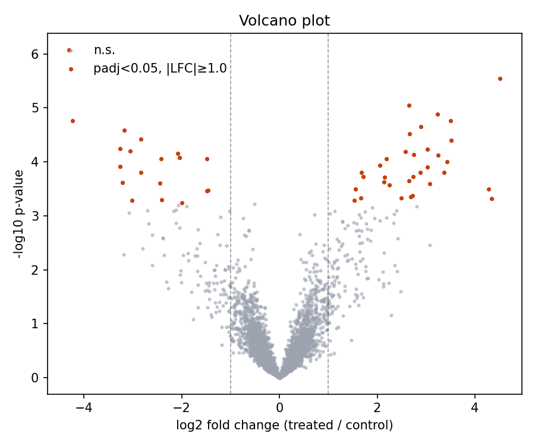
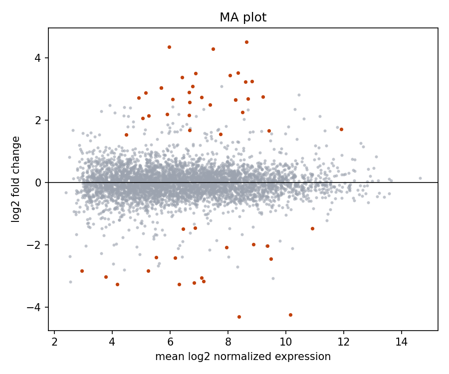
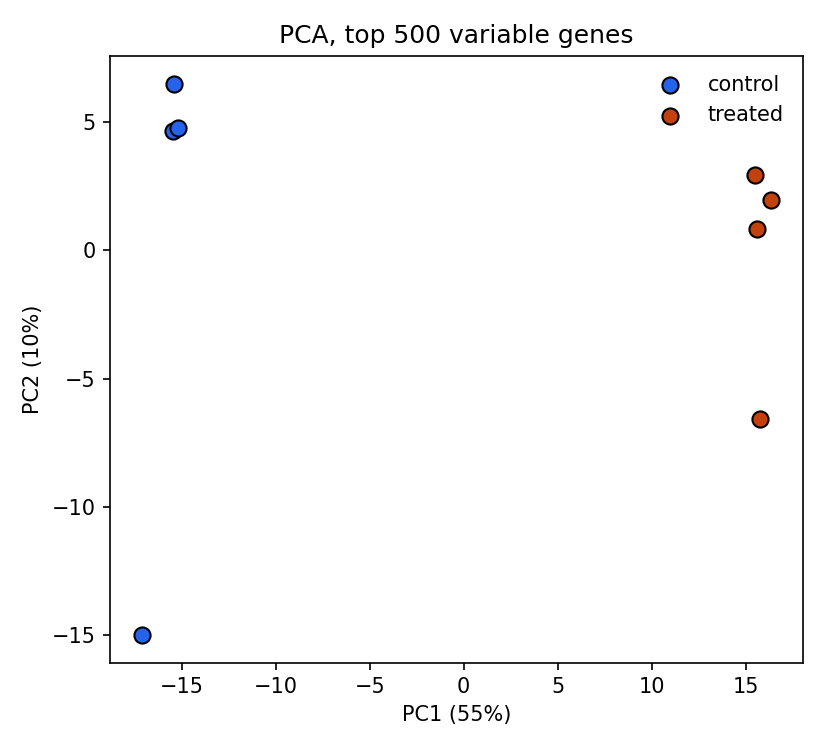

# rnaseq-de

A small Python pipeline for differential gene expression in bulk RNA-seq data. It goes from a counts matrix through normalization and per-gene testing with FDR control to a ranked gene table and diagnostic plots.

When you don't pass data in, it simulates a two-condition experiment with negative-binomial counts and known ground truth. That way the calls can be scored for precision and recall instead of only being looked at.

New to this? Read [EXPLAINED.md](EXPLAINED.md) for a plain-language walkthrough of what this does and what we learned.

| Volcano | MA | PCA |
|---|---|---|
|  |  |  |

## Pipeline

1. **Simulate** (`simulate.py`): log-normal baseline expression, 10% of genes get a fold change of N(0, 1.5) log2 units, per-sample library-size scaling, and NB noise with `var = mu + 0.1·mu²`.
2. **Filter** (`normalize.py`): keep genes with ≥10 counts in ≥3 samples.
3. **Normalize**: DESeq2-style median-of-ratios size factors, then `log2(count / sf + 1)`.
4. **Test** (`stats.py`): per-gene Welch t-test, treated vs control, with Benjamini–Hochberg adjusted p-values.
5. **Evaluate**: precision, recall and observed FDR against the simulated truth.
6. **Plot** (`plots.py`): volcano, MA, and PCA on the 500 most variable genes.

## Quickstart

```bash
python3 -m venv .venv && source .venv/bin/activate
pip install -r requirements-dev.txt

PYTHONPATH=src python -m rnaseq_de.cli                 # simulated data
PYTHONPATH=src python -m rnaseq_de.cli --counts counts.csv --metadata samples.csv
pytest -q
```

`counts.csv` has one row per gene and one column per sample. `samples.csv` is indexed by sample name and has a `condition` column (`control` / `treated`). Outputs are written to `results/`.

## Findings (default simulation, 5,000 genes, 4 vs 4)

| metric | value |
|---|---|
| genes after filtering | 4,389 |
| called at padj < 0.05 | 52 |
| precision | 1.00 |
| recall | 0.12 |

The calls are clean: there were no false positives. Recall is poor, though. With 4 replicates per group, each gene's t-test estimates its variance from 6 degrees of freedom, so many real but modest changes don't reach significance after FDR correction. This is the problem that **moderated statistics** (limma's empirical-Bayes variance shrinkage, DESeq2's dispersion shrinkage) were built to solve, by sharing variance information across genes.

## Next steps

- Add an empirical-Bayes moderated t-test and compare recall against the plain Welch test.
- Sweep replicates per group (3 → 12) and plot a power curve.
- Run on a real public dataset (for example, a GEO series) to see how it holds up outside simulation.
